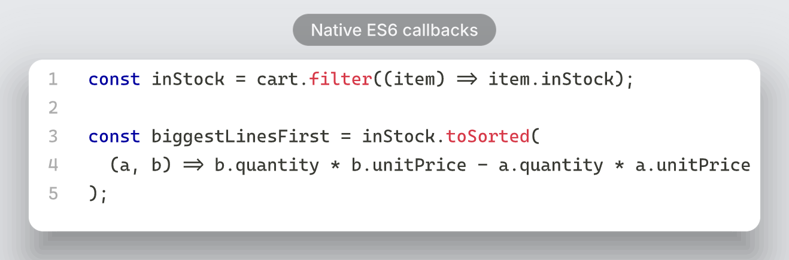
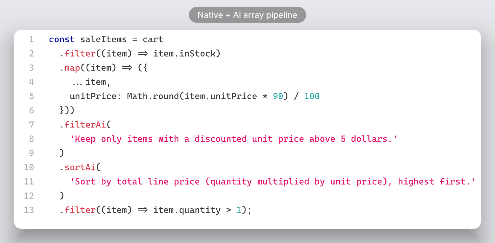

# 🤖 AI Lambda

**AI Lambda is a Vite plugin and demo of compile-time, natural-language array operations.** Describe a sort, filter, or transformation in a string, and the plugin asks OpenAI to generate a small JavaScript function during development or build. The generated function replaces the AI call before the app runs in the browser.

```ts
const expensiveFirst = cart.sortAi(
  'Sort by unit price, highest first.'
);
```

The reusable plugin is published from [`packages/vite-plugin/`](./packages/vite-plugin/); this repository's shopping cart is an example consumer. The browser does not call OpenAI when these operations run.

## 📦 Use the Vite plugin

Install `vite-plugin-ai-lambda` and TypeScript in a Vite project:

```sh
npm install -D vite-plugin-ai-lambda typescript
```

Register `aiCompiler()` in `vite.config.ts` and create an `.ai-rc.json` in the project root. See the [plugin package README](./packages/vite-plugin/README.md) for the complete setup and configuration.

## ✨ What it demonstrates

- `sortAi`, `filterAi`, `mapAi`, and `reduceAi` array operations written as natural-language instructions.
- TypeScript-based inference of the array item schema.
- Build-time generation and validation of simple JavaScript functions.
- Local caching of generated functions.
- Pipelines that combine AI-generated and ordinary JavaScript array operations.

## 🚀 Quick start

### Requirements

- Node.js `^20.19.0` or `>=22.12.0` and npm, as required by Vite 8.
- An OpenAI API key.

### Install and configure

```sh
npm ci
```

Create a local `.ai-rc.json` in the project root:

```json
{
  "apiKey": "YOUR_OPENAI_API_KEY",
  "model": "gpt-4.1-mini",
  "cache": true,
  "generatedDir": ".ai-cache"
}
```

`.ai-rc.json` is excluded from Git. Keep your real API key in this local file; never paste it into source code or commit it. The API key is required in the config, while a cache miss causes the plugin to send a request to OpenAI.

Only `apiKey` is required. The defaults are `gpt-4.1-mini` for `model`, `true` for `cache`, and `.ai-cache` for `generatedDir`.

### Run the demo

```sh
npm run dev
```

Open the local URL printed by Vite. Try the pipeline buttons above the shopping cart to compare different operation sequences.

```sh
npm run build
npm run preview
```

`build` type-checks with TypeScript and creates the production site in `dist/`; `preview` serves that build locally.

## 🧩 How it works

1. The Vite plugin scans project TypeScript and JavaScript for calls named `sortAi`, `filterAi`, `mapAi`, or `reduceAi`.
2. TypeScript infers the item fields and supported field types from the array expression.
3. On a cache miss, the plugin sends the instruction and inferred schema to OpenAI. **It does not send the array's runtime items.**
4. The generated function is validated and, by default, stored under `.ai-cache/`.
5. The AI call is rewritten to a native array operation. The resulting app runs that generated JavaScript—not an AI request—in the browser.

For example:

```ts
items.sortAi('Sort by price, lowest first.');
```

is compiled to the equivalent of:

```ts
items.toSorted((a, b) => a.price - b.price);
```

The exact comparator is generated from your instruction and the inferred schema.

## 🛠️ The AI operations

All instructions must be **string literals**. `sortAi`, `filterAi`, and
`mapAi` take one argument; `reduceAi` takes an instruction and an initial value.

### Sort: `sortAi`

Describe the ordering rule. `sortAi` compiles to `toSorted`, so it returns a sorted copy rather than mutating the original array.

```ts
const byPrice = products.sortAi(
  'Sort by price, lowest first.'
);

const byNaturalName = products.sortAi(
  'Sort by product name in natural alphabetical order.'
);

const byLineTotal = cart.sortAi(
  'Sort by quantity multiplied by unit price, highest first. When totals tie, sort product names alphabetically.'
);
```

### Filter: `filterAi`

Describe which items to keep. The generated predicate compiles to native `filter`.

```ts
const available = products.filterAi(
  'Keep only items that are in stock.'
);

const affordableAccessories = products.filterAi(
  'Keep accessories with a unit price under 50 dollars.'
);
```

### Map: `mapAi`

Describe the output item. Use a TypeScript generic when you want to specify the result type; preserve fields explicitly if they should remain in the output.

```ts
const discounted = products.mapAi(
  'Apply a 10% discount to unitPrice, rounded to two decimals, and keep every other field.'
);

interface ProductSummary {
  name: string;
  priceLabel: string;
}

const summaries = products.mapAi<ProductSummary>(
  'Return an object with name copied from product and priceLabel set to the unit price rounded to two decimals as a string.'
);
```

`mapAi` compiles to native `map`. The generated mapper is checked against the input schema; use a clear instruction and a result type that matches the generated object.

### Reduce: `reduceAi`

Describe how to update the accumulator for each item. The initial value
determines the accumulator and return type.

```ts
const inStockValue = cart.reduceAi(
  'Add each in-stock item quantity multiplied by its unitPrice to the running total.',
  0
);
```

`reduceAi` compiles to native `reduce`; the generated reducer receives `acc`
and `item`.

## 🔗 Compose operations

Native ES6 arrow functions are regular JavaScript callbacks. Use them for
explicit, predictable logic, and use an AI method when a natural-language
instruction is more convenient. Calls in a chain run from left to right.

For example, these native callbacks filter and sort with ordinary JavaScript:



```ts
const inStock = cart.filter((item) => item.inStock);

const biggestLinesFirst = inStock.toSorted(
  (a, b) => b.quantity * b.unitPrice - a.quantity * a.unitPrice
);
```

The same values can flow through native arrow callbacks and AI-powered
operations in one pipeline:



```ts
const saleItems = cart
  .filter((item) => item.inStock)
  .map((item) => ({
    ...item,
    unitPrice: Math.round(item.unitPrice * 90) / 100
  }))
  .filterAi(
    'Keep only items with a discounted unit price above 5 dollars.'
  )
  .sortAi(
    'Sort by total line price (quantity multiplied by unit price), highest first.'
  )
  .filter((item) => item.quantity > 1);
```

Here, the native `filter` and `map` callbacks run as ordinary JavaScript,
`filterAi` and `sortAi` are generated during development/build, and the final
native `filter` runs after them. AI instructions must remain string literals.

You can also use an AI operation before a native arrow callback or native
reducer:

```ts
const totalForAccessories = cart
  .filterAi('Keep only items in the Accessories category.')
  .filter((item) => item.inStock)
  .reduce(
    (total, item) => total + item.quantity * item.unitPrice,
    0
  );
```

Compare filtering before and after a discount to see how operation order
changes the result:

```ts
// The threshold is evaluated against the original unitPrice.
const filterThenDiscount = cart
  .filterAi('Keep items with a unit price above 10 dollars.')
  .mapAi('Reduce unitPrice by 10% and keep all other fields.');

// The threshold is evaluated against the discounted unitPrice.
const discountThenFilter = cart
  .mapAi('Reduce unitPrice by 10% and keep all other fields.')
  .filterAi('Keep items with a unit price above 10 dollars.');
```

The repository's demo offers more combinations—including native `filter`, `toSorted`, and `toReversed` alongside AI operations—in [`src/pipelines.ts`](./src/pipelines.ts).

## ⚖️ AI methods vs. native methods

| Need | AI method | Native method |
|---|---|---|
| Sort by a rule stated in domain language | `items.sortAi('Sort by total price, highest first.')` | Write a comparator such as `items.toSorted((a, b) => b.total - a.total)` |
| Keep items described by a business rule | `items.filterAi('Keep in-stock items below $20.')` | Write a predicate such as `items.filter((item) => item.inStock && item.price < 20)` |
| Transform fields from a natural-language request | `items.mapAi('Apply a 10% discount and keep all fields.')` | Write the transformation explicitly in `items.map(...)` |
| Predictable, simple logic with no generation step | Not necessary | Prefer native methods |
| Logic that benefits from a natural-language specification | Convenient during development/build | Translate the rule into ordinary JavaScript yourself |

| AI-generated operation | Native replacement | Mutates the input? |
|---|---|---|
| `sortAi(instruction)` | `toSorted(comparator)` | No |
| `filterAi(instruction)` | `filter(predicate)` | No |
| `mapAi(instruction)` | `map(mapper)` | No |
| `reduceAi(instruction, initialValue)` | `reduce(reducer, initialValue)` | No |

Prefer native array methods for rules that are straightforward to express in code. AI methods add generation and an OpenAI dependency to development/build; they are useful here for demonstrating how a natural-language rule can become a typed, inspectable function.

## 📐 Supported input schema

The compiler derives the item schema from the array expression. The supported field types are:

| TypeScript field | Inferred type |
|---|---|
| `string` | `string` |
| `number` | `number` |
| `boolean` | `boolean` |
| `Date` | `date` |

For example:

```ts
interface CartItem {
  product: string;
  quantity: number;
  unitPrice: number;
  addedAt: Date;
  inStock: boolean;
}
```

Generated code is restricted to simple expression-bodied arrow functions and schema fields. The configured operations also allow a small set of methods: `localeCompare` and `includes` for string logic, and `Math.round`, `Math.floor`, and `Math.ceil` for mapping. Use fields with consistent supported types; nested or otherwise unsupported field types are not currently handled.

## 🧠 Cache and API behavior

- Caching is enabled by default and stores generated functions in `.ai-cache/`.
- The cache key uses the instruction, inferred schema, and model, so a change to any of these can trigger generation again.
- Set `"cache": false` to request a fresh generated function instead of reading or writing the cache.
- A request is made during Vite development/build on a cache miss for a matching operation.
- The Vite plugin still requires a configured API key even when a cache entry exists.
- The API receives the instruction and field schema—not the array's runtime data.

## 🗂️ Project layout

| Path | Purpose |
|---|---|
| [`vite.config.ts`](./vite.config.ts) | Registers the AI compiler plugin with Vite |
| [`packages/vite-plugin/src/aiCompiler.ts`](./packages/vite-plugin/src/aiCompiler.ts) | Finds AI calls, infers types, and rewrites calls |
| [`packages/vite-plugin/src/openai/`](./packages/vite-plugin/src/openai/) | Requests and extracts generated functions |
| [`packages/vite-plugin/src/config.ts`](./packages/vite-plugin/src/config.ts) | Reads and validates `.ai-rc.json` |
| [`packages/vite-plugin/src/functions/`](./packages/vite-plugin/src/functions/) | Infers schemas and validates generated functions |
| [`packages/vite-plugin/README.md`](./packages/vite-plugin/README.md) | Install and configure the reusable package |
| [`docs/images/`](./docs/images/) | GitHub-themed code examples for this README |
| [`src/ai-macros.d.ts`](./src/ai-macros.d.ts) | Loads the plugin's TypeScript declarations and declares CSS modules |
| [`src/pipelines.ts`](./src/pipelines.ts) | Demo pipelines with AI and native array methods |
| [`src/cart.ts`](./src/cart.ts) | Sample typed cart data |

## ⚠️ Current limitations

- AI instructions must be literal strings so the compiler can read them before runtime.
- The plugin only recognizes the supported method names in project `.js`, `.jsx`, `.ts`, and `.tsx` files; it skips `node_modules`.
- Input schemas currently support string, number, boolean, and `Date` fields, not arbitrary nested structures.
- Generated functions are deliberately limited; they are not general-purpose JavaScript.
- The API key and network access are needed for generation. A browser-only runtime cannot generate missing functions.
- This repository has no dedicated test script; `npm run build` builds the plugin package, runs the configured TypeScript check, and creates the demo site.

## 📄 License

ISC. See the [`package.json`](./package.json) for project metadata.
