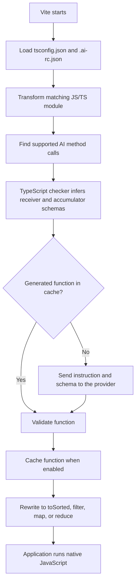

# vite-plugin-ai-lambda

[](https://www.npmjs.com/package/vite-plugin-ai-lambda)
[](https://www.npmjs.com/package/vite-plugin-ai-lambda)
[](#license)
[](https://vite.dev)
[](https://www.typescriptlang.org)

Turn plain-English instructions into array operations at **Vite transform time**.

Write `sortAi`, `filterAi`, `findAi`, `someAi`, `mapAi`, or `reduceAi`. The plugin asks your configured AI provider (OpenAI, Anthropic, Gemini, or an OpenAI-compatible endpoint) to generate a small JavaScript function during `vite` or `vite build`, validates it, and rewrites your call to a native array method. The browser never calls the provider.

```ts
const cheapestFirst = products.sortAi('Sort by price, lowest first.');
```

```js
// What the app actually ships
const cheapestFirst = products.toSorted((a, b) => a.price - b.price);
```

## Table of contents

- [Features](#features)
- [Requirements](#requirements)
- [Installation](#installation)
- [Quick start](#quick-start)
- [Configuration](#configuration)
- [Usage](#usage)
- [API reference](#api-reference)
- [Supported types and helpers](#supported-types-and-helpers)
- [How it works](#how-it-works)
- [Caching](#caching)
- [Security model](#security-model)
- [Known limitations](#known-limitations)
- [Troubleshooting](#troubleshooting)
- [FAQ](#faq)
- [Metrics](#metrics)
- [Test coverage](#test-coverage)
- [Development](#development)
- [Contributing](#contributing)
- [Reporting security issues](#reporting-security-issues)
- [License](#license)

## Features

- **Natural-language array methods**: `sortAi`, `filterAi`, `findAi`, `someAi`, `mapAi`, and `reduceAi`.
- **Zero runtime AI cost**: the output is plain JavaScript; no AI code ships to the browser.
- **Build-time generation** during both `vite` (dev server) and `vite build`.
- **Persistent cache** of generated functions, so repeat builds make no API calls.
- **Resilient provider calls**: 60-second timeout, and automatic retries with backoff for network errors, 408, 429, and 5xx responses (honoring `Retry-After`).
- **Type-aware**: field schemas are inferred from your `tsconfig.json` through TypeScript's compiler API.
- **Validated output**: generated code must pass a restricted grammar before it is used.
- **Chainable**: combine AI methods with each other and with native array methods.
- **Actionable errors**: failures name the call site, instruction, cause, and a suggested fix.
- **Small footprint**: one runtime dependency (`magic-string`), no telemetry.

## Requirements

| Requirement | Version |
|---|---|
| Vite | `>=6.0.0` (peer dependency) |
| TypeScript | `>=7.0.2 <8.0.0` (peer dependency, installed in your project) |
| Provider | Network access when a function must be generated |
|---|---|
| OpenAI, Anthropic, Gemini, or an OpenAI-compatible endpoint | API key (optional for a keyless `openai-compatible` server) and network access (see [Providers](#providers)) |
| Runtime | Browsers or Node.js with `Array.prototype.toSorted` (or a polyfill) for `sortAi` |

The plugin uses TypeScript's **unstable** synchronous compiler API (`typescript/unstable/sync`), which is why TypeScript is pinned to the 7.x range.

## Installation

```sh
npm install -D vite-plugin-ai-lambda typescript vite
```

## Quick start

**1. Register the plugin** in `vite.config.ts`:

```ts
import { defineConfig } from 'vite';
import { aiCompiler } from 'vite-plugin-ai-lambda';

export default defineConfig({
  plugins: [aiCompiler()]
});
```

**2. Add `.ai-rc.json`** next to `tsconfig.json` in your Vite project root:

```json
{
  "apiKey": "YOUR_OPENAI_API_KEY",
  "model": "gpt-4.1-mini",
  "cache": true,
  "generatedDir": ".ai-cache"
}
```

To use another provider, set `provider` and `model` (see [Providers](#providers)).

**3. Keep secrets and the cache out of version control:**

```gitignore
.ai-rc.json
.ai-cache/
```

**4. (Optional) Enable the array method types** if your `vite.config.ts` is excluded from your app's TypeScript project, add a `.d.ts` file included by your `tsconfig.json`:

```ts
/// <reference types="vite-plugin-ai-lambda" />
```

## Configuration

Create `.ai-rc.json` in the resolved Vite root (the `root` option, or the directory Vite runs in).

| Option | Type | Default | Description |
|---|---|---|---|
| `provider` | `string` | `"openai"` | One of `"openai"`, `"anthropic"`, `"gemini"`, or `"openai-compatible"`. |
| `apiKey` | `string` | none (**required** except for `openai-compatible`) | API key for the selected provider. Checked at startup, even when every function is cached. Optional for `openai-compatible`, where no `Authorization` header is sent when it is omitted. |
| `model` | `string` | `"gpt-4.1-mini"` for `openai`; **required** for other providers | Model used for generation. It must support structured JSON output. |
| `baseUrl` | `string` | none | Required for `openai-compatible` and rejected for other providers. The base URL of the endpoint, for example `http://localhost:11434/v1`. |
| `cache` | `boolean` | `true` | When `true`, generated functions are read from and written to `generatedDir`. `false` skips both. |
| `generatedDir` | `string` | `".ai-cache"` | Cache directory, relative to the Vite root. |

Only `apiKey` is required for `openai`, `anthropic`, and `gemini`. The key is read only from `.ai-rc.json`; there is no environment-variable fallback.

The file is validated at startup. The plugin fails the build if the file is not a JSON object, contains keys other than the ones above (so typos are caught), or has a value of the wrong type. `generatedDir` must be a relative path that stays inside the Vite root.

### Providers

| `provider` | Service | Example `.ai-rc.json` |
|---|---|---|
| `openai` (default) | OpenAI Responses API | `{ "apiKey": "...", "model": "gpt-4.1-mini" }` |
| `anthropic` | Anthropic Messages API | `{ "provider": "anthropic", "apiKey": "...", "model": "claude-sonnet-4-5" }` |
| `gemini` | Google Gemini `generateContent` API | `{ "provider": "gemini", "apiKey": "...", "model": "gemini-2.5-flash" }` |
| `openai-compatible` | Any server that implements `POST {baseUrl}/chat/completions` with JSON schema output | `{ "provider": "openai-compatible", "apiKey": "...", "model": "llama3.1", "baseUrl": "http://localhost:11434/v1" }` |

Each provider uses the same prompt and validation. Only `openai-compatible` may omit `apiKey`, for local servers that need no key (for example, Ollama with `"baseUrl": "http://localhost:11434/v1"`). Cost estimates in the build report are only shown for `openai`, where built-in prices exist. Cache files for `openai` are unchanged; other providers add their provider and base URL to the cache key, so switching providers regenerates functions.

The Anthropic, Gemini, and OpenAI-compatible integrations are tested against mocked HTTP responses. Check the first build's output against your provider's dashboard, because server behaviour varies between vendors.


## Usage

Every instruction **must be a string literal**. Methods chain with each other and with native array methods.

| Method | Compiles to | Generated function |
|---|---|---|
| `sortAi(instruction)` | `toSorted` | Comparator `(a, b)` |
| `filterAi(instruction)` | `filter` | Predicate `(item)` |
| `findAi(instruction)` | `find` | Predicate `(item)` |
| `someAi(instruction)` | `some` | Predicate `(item)` |
| `mapAi(instruction)` | `map` | Mapper `(item)` |
| `reduceAi(instruction, initialValue)` | `reduce` | Reducer `(acc, item)` |

```ts
const cheapestFirst = products.sortAi('Sort by price, lowest first.');

const available = products.filterAi('Keep only items that are in stock.');

const firstAvailable = products.findAi('Find the first item that is in stock.');

const hasOutOfStock = products.someAi('Match any item that is out of stock.');

const discounted = products.mapAi(
  'Reduce price by 10%, rounded to two decimals, and keep every other field.'
);

const total = products.reduceAi(
  'Add each item price multiplied by its quantity to the running total.',
  0
);
```

### Chaining

```ts
const revenue = orders
  .filterAi('Keep completed orders only.')
  .sortAi('Sort by total from highest to lowest.')
  .reduceAi<number>('Add each order total to the running revenue.', 0);
```

### Type arguments

- `sortAi` returns a new array because it compiles to `toSorted`; the input is not mutated.
- `mapAi<U>` and `reduceAi<U>` accept a type argument that describes the result to TypeScript. The plugin type-checks the generated function at build time against the declared types: field value types, required and optional fields, `null` and `undefined` in nullable fields, and nested object fields are all checked. Scalar and array results are checked against `U` as well. Comparators must return `number`, and predicates for `filterAi`, `findAi`, and `someAi` must return `boolean`, so an expression such as `item.name && x` is rejected.
- For an empty array, pass an explicit type so `reduceAi` knows the accumulator type:

```ts
const selected = products.reduceAi<Product[]>(
  'Return a new array containing products with a price above 50.',
  []
);
```

## API reference

The package augments the global `Array<T>` interface with these methods (declared in `dist/ai-macros.d.ts`):

```ts
interface Array<T> {
  sortAi(instruction: string): T[];
  filterAi(instruction: string): T[];
  findAi(instruction: string): T | undefined;
  someAi(instruction: string): boolean;
  mapAi<U = T>(instruction: string): U[];
  reduceAi<U>(instruction: string, initialValue: U): U;
}
```

| Export | Kind | Description |
|---|---|---|
| `aiCompiler()` | function | Returns the Vite plugin. Call it with no arguments; configuration comes from `.ai-rc.json` and `tsconfig.json`. |
| `AIConfig` | type | Shape of `.ai-rc.json`: `apiKey`, `provider`, `model`, `baseUrl`, `cache`, `generatedDir`. |

## Supported types and helpers

The TypeScript checker supports arrays of objects with simple scalar fields:

| TypeScript field type | Inferred schema |
|---|---|
| `string` | `string` |
| `number` | `number` |
| `boolean` | `boolean` |
| `Date` | `date` |

Nested objects, unsupported field types, and mixed unions (such as `string | number`) are rejected at build time with an error naming the field.

Generated code must be an **expression-bodied arrow function** with the expected parameter names. Only these helpers are allowed:

| Method | Allowed helpers |
|---|---|
| `sortAi` | `localeCompare` |
| `filterAi` | `localeCompare`, `includes` |
| `findAi` | `localeCompare`, `includes` |
| `someAi` | `localeCompare`, `includes` |
| `mapAi` | `localeCompare`, `includes`, `Math.round`, `Math.floor`, `Math.ceil` |
| `reduceAi` | `localeCompare`, `includes`, `Math.round`, `Math.floor`, `Math.ceil` |

## How it works



1. On startup, the plugin loads `tsconfig.json` and `.ai-rc.json` and verifies the API key when the provider requires one.
2. For each `.js`, `.jsx`, `.ts`, or `.tsx` module (excluding `node_modules`), it finds supported AI calls.
3. The TypeScript checker infers the element schema of the receiver array (and the accumulator type for `reduceAi`).
4. On a cache miss, the instruction, the inferred schema, and the method's rules are sent to the configured provider's API (OpenAI Responses, Anthropic Messages, Gemini `generateContent`, or `{baseUrl}/chat/completions`). **Array contents are never sent.**
5. The generated function is validated, cached (if enabled), and the call is rewritten.
6. Each generation is logged through Vite's logger: the instruction when it starts, and the generated function when it finishes. Identical concurrent generations share one OpenAI request.

If generation or validation fails, the transform fails. The plugin never leaves an uncompiled AI call in the output.

For a detailed diagram of where the plugin attaches to Vite's hooks and plugin order, see [docs/architecture.md](./docs/architecture.md).

## Caching

Generated functions are stored as JSON files in `generatedDir`, named by a hash of:

- the instruction,
- the inferred schema,
- the model,
- the plugin's compiler version,
- parameter schemas (for `reduceAi`, the accumulator's schema).

Changing any of these triggers regeneration. Cached files contain the generated JavaScript, so you can review them directly.

**Ignore the cache** (default, recommended for most projects) or **commit it** if you want CI builds to run without provider access or cost. Committing it means reviewing new cache files in pull requests like any other code.

To force regeneration, delete the relevant file in `.ai-cache/` or the whole directory.

Cache writes are atomic (written to a temporary file, then renamed), so an interrupted build does not leave a partial file. If a cached file is unreadable or invalid, the plugin logs a warning and regenerates it.

## Build output

Each AI call logs its model, duration, attempts, token usage, and estimated cost. Cache hits are logged as `cache hit` with no API call.

When `vite build` finishes (and after each rebuild in watch mode), the plugin prints a summary: call counts, token totals, estimated cost, API and build time, and the slowest call. With `vite` (dev server), the summary prints about two seconds after AI activity settles, and again when the server shuts down. Dev totals accumulate across the session.

Costs are estimates from a built-in table of standard-tier list prices per 1M tokens, not billing data. Models without an entry show `cost n/a`. Check your OpenAI invoice for actual charges.

## Security model

- **Your API key** lives in `.ai-rc.json`. Never commit it.
- **Your data** stays local: only the instruction and the type schema leave your machine, and only on a cache miss.
- **Generated code is validated, not sandboxed.** The validator rejects computed or optional access, accessor definitions, prototype-related properties, shorthand or computed object keys, loose equality, coercive arithmetic, `this`/`super`, unknown identifiers, undeclared fields, and calls outside each method's helper list. Object spread is limited to object parameters and array spread to array parameters.
- **Validation is not a JavaScript sandbox.** Reading or spreading application data can still invoke getters or proxy traps on those objects. Review generated behavior and runtime data as you would any application code.
- **No telemetry.** The only network call is the provider request on a cache miss.

## Known limitations

- Only arrays of objects with `string`, `number`, `boolean`, or `Date` fields are supported. Nested objects and mixed unions are not.
- Generated functions are type-checked with the TypeScript checker against the declared types. Field value types, required and optional fields, nullable fields, and nested objects are verified for `mapAi<U>` and `reduceAi<U>`. Scalar and array results are checked too. Comparators must return `number` and predicates must return `boolean`. Reducer accumulators must match the declared accumulator type.
- The API key is only read from `.ai-rc.json`; there is no environment-variable fallback.
- The key is required even when every function is cached.
- `sortAi` needs `Array.prototype.toSorted` at runtime (or a polyfill).
- Output quality depends on the model and the instruction. Ambiguous instructions may fail validation; simplify them and retry.
- The TypeScript integration uses an unstable API, so the TypeScript peer range is pinned to 7.x.

## Troubleshooting

Configuration and transform errors are prefixed with `[ai-compile-time]`.

| Symptom | Check |
|---|---|
| Missing config or API key | Put `.ai-rc.json` at the resolved Vite root and set `apiKey`. The key is checked even for cache hits. It is optional only for `openai-compatible`. |
| TypeScript config error | Ensure a valid `tsconfig.json` is at the same root. |
| `items must be an array` | Check that the expression before the AI method has an array type in the project's TypeScript program. |
| `Unable to type-check AI call` / `source does not match the TypeScript project` | Make sure the file is included in `tsconfig.json`, and that no other plugin rewrites the source before this one runs. |
| Unsupported field type | Use `string`, `number`, `boolean`, or `Date` fields; avoid mixed unions and nested objects. |
| Invalid invocation | Pass a literal string; `reduceAi` also needs an initial value. Type arguments are supported only on `mapAi` and `reduceAi`. |
| `Invalid cached ...` warning | The plugin regenerates the entry automatically. If it keeps happening, delete the file in `generatedDir`. |
| `<Provider> error 401` / `429` / `5xx` | Verify the key, model name, and model access (401). For 429 and 5xx, the plugin already retried; check quota and rate limits, or retry the build later. |
| `<Provider> request failed after N attempt(s)` | Check connectivity, proxy settings, and `baseUrl` for `openai-compatible`. The plugin already retried, and each request times out after 60 seconds. |
| Generation refused or validation error | Simplify the instruction to supported fields and helpers, then retry. |
| `sortAi` missing at runtime | Confirm the plugin is registered and the call is in a transformed JS/TS module. Check `toSorted` support too. |

Errors include the failing call site, instruction, model, underlying cause, and a suggested next step. Configuration errors identify the resolved Vite root and expected config files.

## FAQ

**Does my array data go to the provider?**
No. Only the instruction and the inferred field schema are sent, and only when a function is not cached.

**Is the same instruction always compiled the same way?**
The cache makes the output stable across builds. A fresh generation may differ, so commit the cache or review the generated file if you need a fixed result.

**Can I see the generated code?**
Yes. Open the JSON file in `.ai-cache/`. The transformed source also contains the native method call.

**Does it work in production builds?**
Yes. Functions are generated at build time, and the shipped bundle contains only native JavaScript.

**Why does `sortAi` return a new array?**
It compiles to `toSorted`, which does not mutate the input.

**Can I use it with `filterAi`, `mapAi`, and `reduceAi` without a generic?**
Yes. The generic is optional. Use it when you need a specific result type for `mapAi` or an empty-array `reduceAi`.

## Metrics

Measured on version `0.4.2` (2026-11-01).

| Metric | Value |
|---|---|
| Version | `0.4.2` |
| Runtime dependencies | 1 (`magic-string` 1.4.5) |
| Peer dependencies | `vite >=6.0.0`, `typescript >=7.0.2 <8.0.0` |
| Source files | 25 TypeScript files, 4,102 lines |
| Test files | 11 test files, 139 tests, 2,212 lines of test code |
| Test run time | ~2.4 s |
| Published package | 52 files, 49.6 kB packed, 188.1 kB unpacked |
| License | ISC |

## Test coverage

Coverage is measured with [Vitest](https://vitest.dev) and V8 (`npm run test:coverage`). The configured thresholds are 80% for branches, functions, lines, and statements, enforced per file.

**Configured scope** (the modules listed in `vitest.config.ts`):

| Metric | Coverage | Covered / total |
|---|---|---|
| Statements | **91.48%** | 462 / 505 |
| Branches | **85.88%** | 438 / 510 |
| Functions | **97.22%** | 70 / 72 |
| Lines | **93.30%** | 432 / 463 |

**Per file:**

| File | Statements | Branches | Functions | Lines |
|---|---|---|---|---|
| `aiCompiler.ts` | 94.64% | 87.50% | 90.90% | 94.23% |
| `functions/inferSchema.ts` | 85.60% | 82.97% | 94.11% | 91.89% |
| `functions/validateAiFunction.ts` | 89.03% | 82.64% | 100% | 89.33% |
| `openai/extractGeneratedText.ts` | 95.83% | 91.66% | 100% | 100% |
| `openai/generateAiFunction.ts` | 95.94% | 87.50% | 100% | 95.71% |
| `transform/transformModule.ts` | 100% | 100% | 100% | 100% |
| `utils.ts` | 100% | 100% | 100% | 100% |

**Across all of `src/`** (includes modules outside the configured scope):

| Metric | Coverage | Covered / total |
|---|---|---|
| Statements | 91.77% | 748 / 815 |
| Branches | 84.56% | 663 / 784 |
| Functions | 97.76% | 131 / 134 |
| Lines | 93.34% | 701 / 751 |

Modules outside the configured thresholds are not held to the 80% floor. Of these, `errorContext.ts` is the least covered (54.83% statements, 33.33% branches). The new `providers/` modules are 91-100% on statements, with `openaiCompatible.ts` at 78.94% branches and `gemini.ts` at 83.33%. Adding these to `vitest.config.ts` is a good next step.

## Development

This package is a workspace of the [ai-lambda](https://github.com/rand0mC0d3r/ai-lambda) repository. From the repository root:

```sh
npm install
npm test                 # run unit tests (all workspaces)
npm run test:coverage    # run tests with coverage report
```

From this package directory (`packages/vite-plugin`):

```sh
npm run build            # compile src/ to dist/ with tsc
npm test                 # vitest run
npm run test:coverage    # vitest run --coverage (HTML report in coverage/)
npm run test:coverage    # vitest run --coverage (HTML report in coverage/)
npm run bench            # run benchmarks in bench/ (tinybench, times are not CI gates)
npm pack --dry-run       # inspect what will be published
```

Benchmarks in `bench/` cover the warm-cache rebuild path (`transformModule`, with 1, 5, and 20 AI calls), the early return for modules without AI calls, `validateAiFunction`, and `extractGeneratedText`. They run through `vitest.bench.config.ts` and use [tinybench](https://github.com/tinylibs/tinybench) for sampling. Fetch is stubbed, so timings never include network calls. Vitest 5 no longer provides a `bench` API, so the timing is done by a `measure` helper.

### Project layout

```text
src/
  aiCompiler.ts           Vite plugin entry point
  ai-macros.ts            Global Array method declarations
  aiFunctions.ts          AIFunctionSpec type for method specs
  constants.ts            Defaults and per-method specs
  errorContext.ts         Error decoration with cause and insight
  utils.ts                Record guard and SHA-256 hashing for cache keys
  functions/              Schema inference and generated-function validation
  providers/              Provider abstraction: OpenAI, Anthropic, Gemini, OpenAI-compatible
  openai/                 OpenAI-specific response parsing and usage/cost accounting
  transform/              Module scanning and call rewriting
  translations/en.ts      User-facing messages
test/                     Vitest suites mirroring src/
```

## Contributing

Contributions are welcome.

1. Open an issue first for larger changes so the approach can be agreed.
2. Create a branch and keep changes focused.
3. Add or update tests for behavior changes. Run `npm test` and `npm run build` before opening a pull request.
4. Keep the validator strict: new helpers or syntax need tests that show why they are safe.
5. Update this README when user-facing behavior, configuration, or metrics change.

Commit messages follow the [Conventional Commits](https://www.conventionalcommits.org) style used in this repository (`feat:`, `fix:`, `refactor:`, `docs:`).

## Reporting security issues

Please do not open a public issue for a vulnerability, especially one involving the validator, generated code execution, or API key handling. Report it privately through [GitHub security advisories](https://github.com/rand0mC0d3r/ai-lambda/security/advisories/new).

## License

[ISC](https://opensource.org/licenses/ISC)
