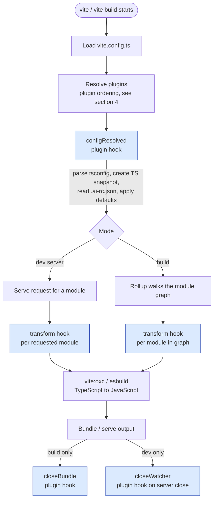
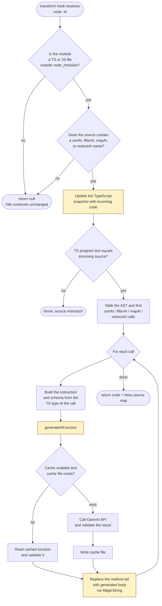
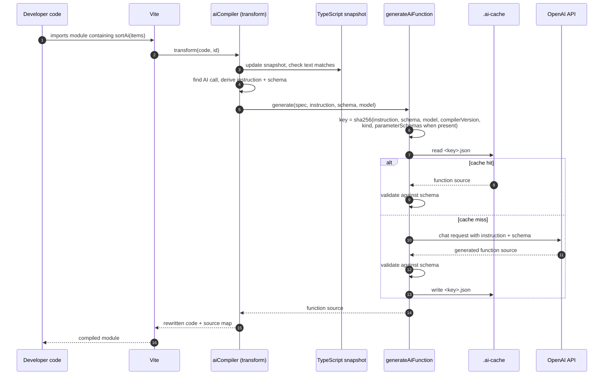

# Architecture: how `vite-plugin-ai-lambda` fits into Vite

This document explains where the plugin attaches to Vite's pipeline, which hooks it uses, and what happens to each module it sees.

## 1. Vite lifecycle and plugin hooks

The plugin uses four hooks. Blue nodes in the diagram are plugin hooks.

| Hook | When it runs | What the plugin does |
| --- | --- | --- |
| `configResolved` | Once, after the Vite config is resolved | Parses the tsconfig through the TypeScript API, builds the program snapshot, reads `.ai-rc.json`, requires `apiKey`, and applies defaults (`gpt-4.1-mini`, `cache: true`, `.ai-cache`). |
| `transform` | Once per module (build) or once per request (dev) | Rewrites `sortAi`, `filterAi`, `mapAi`, and `reduceAi` call sites in TypeScript source files. See section 2. |
| `closeBundle` | Once, at the end of `vite build` (skipped in watch builds, which reuse the API across rebuilds) | Disposes the TypeScript snapshot and closes the TypeScript API. |
| `closeWatcher` | When the dev server closes | Same cleanup as `closeBundle`. |

## 2. Per-module transform flow

This is what happens inside the `transform` hook for each module.

Notes on the flow:

- Only the method tail is rewritten. The plugin replaces the text from `items.end` to `node.end`, so the rest of the file keeps its original text and layout.
- The source map is hires, so stack traces and breakpoints still point at the original TypeScript lines.
- Cache hits are still validated. A cached function that cannot be parsed or no longer matches the schema raises an error; it is not regenerated automatically. Delete the cache file to force a new generation.
- Each call maps to a native method by its spec: `sortAi` to `toSorted`, `filterAi` to `filter`, `mapAi` to `map`, and `reduceAi` to `reduce`. The spec also sets the allowed helper methods and output role for the generated function.

## 3. An AI array call (sequence view)

The sequence below uses `sortAi`. The other methods follow the same path with their own spec.

## 4. Where the plugin sits in the plugin order

The plugin sets `enforce: 'pre'`. Vite sorts plugins into groups, and pre plugins run before Vite's own TypeScript transform. This is why the plugin sees raw TypeScript.

Relevant order, from `resolvePlugins` in Vite 8:

1. Internal core plugins (optimized deps, alias, and so on)
2. User plugins with `enforce: 'pre'`, in array order. **`vite-plugin-ai-lambda` runs here.**
3. Vite core transforms, including `vite:oxc` (Vite 8). Earlier versions use esbuild.
4. User plugins with no `enforce` setting, in array order
5. Build and output plugins
6. User plugins with `enforce: 'post'`, in array order

Practical consequences:

- Put `aiCompiler()` anywhere in the `plugins` array. The `pre` flag sorts it correctly.
- Plugins that also use `enforce: 'pre'` run in array order relative to this plugin. If another plugin rewrites TypeScript in a way that breaks the source-match check, put it after `aiCompiler()`.

## 5. Dev vs build

| Aspect | Dev server | Production build |
| --- | --- | --- |
| When `transform` runs | Lazily, when the browser requests the module | For every module reachable from the entry point |
| Work done per module | Only for modules that are requested | For every reachable module |
| Cache effect | Repeat requests reuse the cache | The cache avoids repeated OpenAI calls across builds |
| Watch behavior | Changing a source file re-runs `transform` for that file | Not applicable |

## 6. Files involved

| File | Role in the pipeline |
| --- | --- |
| [src/aiCompiler.ts](../src/aiCompiler.ts) | Plugin entry. Declares hooks and `enforce: 'pre'`. |
| [src/transform/transformModule.ts](../src/transform/transformModule.ts) | Per-module filter, source-match check, AST walk, and MagicString rewrite. |
| [src/openai/generateAiFunction.ts](../src/openai/generateAiFunction.ts) | Cache key, cache read and write, OpenAI call, and validation. |
| [src/translations/en.ts](../src/translations/en.ts) | User-facing error messages. |
| [src/errorContext.ts](../src/errorContext.ts) | Adds the `[ai-compile-time]` prefix and extra context to errors. |
