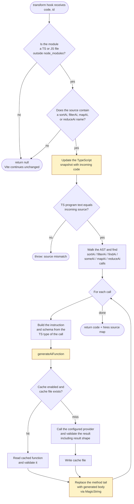
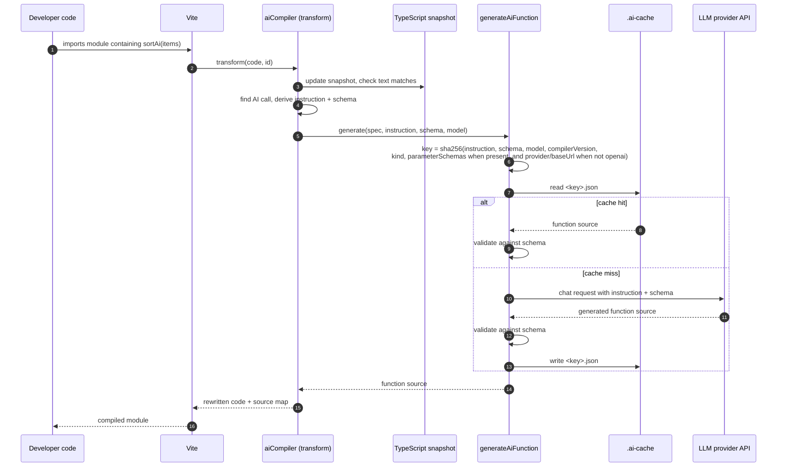
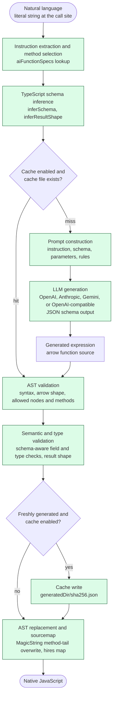

# Architecture: how `vite-plugin-ai-lambda` fits into Vite

This document explains where the plugin attaches to Vite's pipeline, which hooks it uses, and what happens to each module it sees.

## 1. Vite lifecycle and plugin hooks

The plugin uses four hooks. Blue nodes in the diagram are plugin hooks.

| Hook | When it runs | What the plugin does |
| --- | --- | --- |
| `configResolved` | Once, after the Vite config is resolved | Parses the tsconfig through the TypeScript API, builds the program snapshot, then reads `.ai-rc.json` through `readAiConfig`. That step rejects non-object JSON, unknown keys, wrong value types, a missing or empty `apiKey` (unless `provider` is `openai-compatible`), an unknown `provider`, a missing `model` for non-OpenAI providers, a `baseUrl` that is missing for `openai-compatible` or set for another provider, and a `generatedDir` outside the Vite root. It then applies defaults (`provider: openai`, `gpt-4.1-mini` for OpenAI, `cache: true`, `.ai-cache`). |
| `transform` | Once per module (build) or once per request (dev) | Rewrites `sortAi`, `filterAi`, `findAi`, `someAi`, `mapAi`, and `reduceAi` call sites in TypeScript source files. See section 2. |
| `closeBundle` | Once, at the end of `vite build` (skipped in watch builds, which reuse the API across rebuilds) | Disposes the TypeScript snapshot and closes the TypeScript API. |
| `closeWatcher` | When the dev server closes | Same cleanup as `closeBundle`. |

## 2. Per-module transform flow

This is what happens inside the `transform` hook for each module.

Notes on the flow:

- Only the method tail is rewritten. The plugin replaces the text from `items.end` to `node.end`, so the rest of the file keeps its original text and layout.
- The source map is hires, so stack traces and breakpoints still point at the original TypeScript lines.
- Cache hits are still validated. A cached function that cannot be read or no longer passes validation is logged with a warning and regenerated, rather than failing the build. Delete the cache file to force a new generation.
- For `mapAi<U>` and `reduceAi<U>`, validation type-checks the generated function against the declared result type. Required and optional fields, value types, nullable fields, nested objects, and scalar or array results are all checked. Comparators must return `number` and predicates must return `boolean`.
- Each call maps to a native method by its spec: `sortAi` to `toSorted`, `filterAi` to `filter`, `findAi` to `find`, `someAi` to `some`, `mapAi` to `map`, and `reduceAi` to `reduce`. The spec also sets the allowed helper methods and output role for the generated function.

## 3. An AI array call (sequence view)

The sequence below uses `sortAi`. The other methods follow the same path with their own spec.

## 4. Where the plugin sits in the plugin order

The plugin sets `enforce: 'pre'`. Vite sorts plugins into groups, and pre plugins run before Vite's own TypeScript transform. This is why the plugin sees raw TypeScript.

Relevant order, from `resolvePlugins` in Vite 8:

1. Internal core plugins (optimized deps, alias, and so on)
2. User plugins with `enforce: 'pre'`, in array order. **`vite-plugin-ai-lambda` runs here.**
3. Vite core transforms, including `vite:oxc` (Vite 8). Earlier versions use esbuild.
4. User plugins with no `enforce` setting, in array order
5. Build and output plugins
6. User plugins with `enforce: 'post'`, in array order

Practical consequences:

- Put `aiCompiler()` anywhere in the `plugins` array. The `pre` flag sorts it correctly.
- Plugins that also use `enforce: 'pre'` run in array order relative to this plugin. If another plugin rewrites TypeScript in a way that breaks the source-match check, put it after `aiCompiler()`.

## 5. Dev vs build

| Aspect | Dev server | Production build |
| --- | --- | --- |
| When `transform` runs | Lazily, when the browser requests the module | For every module reachable from the entry point |
| Work done per module | Only for modules that are requested | For every reachable module |
| Cache effect | Repeat requests reuse the cache | The cache avoids repeated provider calls across builds |
| Watch behavior | Changing a source file re-runs `transform` for that file | Not applicable |

## 6. Files involved

| File | Role in the pipeline |
| --- | --- |
| [src/aiCompiler.ts](../src/aiCompiler.ts) | Plugin entry. Declares hooks and `enforce: 'pre'`. |
| [src/config.ts](../src/config.ts) | Reads and validates `.ai-rc.json`, then applies defaults. |
| [src/transform/transformModule.ts](../src/transform/transformModule.ts) | Per-module filter, source-match check, AST walk, and MagicString rewrite. |
| [src/openai/generateAiFunction.ts](../src/openai/generateAiFunction.ts) | Cache key, cache read and write, and the provider call. |
| [src/providers/index.ts](../src/providers/index.ts) | Selects the provider (`openai`, `anthropic`, `gemini`, `openai-compatible`) and shares the HTTP retry logic. |
| [src/functions/inferSchema.ts](../src/functions/inferSchema.ts) | Infers the item schema and the result shape from TypeScript types. |
| [src/functions/validateAiFunction.ts](../src/functions/validateAiFunction.ts) | Validates generated functions: syntax, allowed methods, and result shape. |
| [src/translations/en.ts](../src/translations/en.ts) | User-facing error messages. |
| [src/errorContext.ts](../src/errorContext.ts) | Adds the `[ai-compile-time]` prefix and extra context to errors. |

## 7. Compiler core, independent of Vite

Only [src/aiCompiler.ts](../src/aiCompiler.ts) imports `vite`. The stages below run on a source string, a file name, a TypeScript project, and a config. They do not depend on Vite hooks, so another bundler or compiler integration can call the same core.

Green nodes are bundler-independent. The diagram has no Vite-specific nodes.

| Stage | Implementation | Notes |
| --- | --- | --- |
| Natural language input | Call-site `instruction` argument | Must be a string literal. The compiler reads it without running code. |
| Instruction extraction and method selection | [src/transform/transformModule.ts](../src/transform/transformModule.ts), [src/constants.ts](../src/constants.ts) | Picks the spec (`sortAi`, `filterAi`, `findAi`, `someAi`, `mapAi`, `reduceAi`) by method name. The instruction is not parsed; it is passed to the LLM as text. |
| TypeScript schema inference | [src/functions/inferSchema.ts](../src/functions/inferSchema.ts) | Uses the TypeScript checker to derive item fields, accumulator schema, and result shape. |
| Cache lookup | [src/openai/generateAiFunction.ts](../src/openai/generateAiFunction.ts) | Key is a hash of instruction, schema, model, compiler version, and kind. A hit skips prompt, LLM, and cache write. |
| Prompt construction | [src/openai/generateAiFunction.ts](../src/openai/generateAiFunction.ts) | Sends instruction, schema, parameter schemas, and the spec's rules. Array data is not sent. |
| LLM generation | [src/providers/](../src/providers/) (per-provider files), [src/openai/generateAiFunction.ts](../src/openai/generateAiFunction.ts), [src/openai/extractGeneratedText.ts](../src/openai/extractGeneratedText.ts) | Requests strict JSON output with one function field. Each provider maps the request to its own API format. |
| Generated expression | Output field of the response | Parsed as a single arrow function. |
| AST validation | [src/functions/validateAiFunction.ts](../src/functions/validateAiFunction.ts) | Parses the expression with the TypeScript API. Checks syntax, parameters, and an allowlist of node kinds, operators, and methods. |
| Semantic and type validation | [src/functions/validateAiFunction.ts](../src/functions/validateAiFunction.ts) | Uses the inferred schema to check field access, numeric operators, and result fields. It does not run TypeScript's semantic diagnostics on the generated code. |
| Cache write | [src/openai/generateAiFunction.ts](../src/openai/generateAiFunction.ts) | Runs only after a fresh generation passes validation. |
| AST replacement and sourcemap | [src/transform/transformModule.ts](../src/transform/transformModule.ts) | Overwrites the method tail with `MagicString` and returns a hires source map. |

### Boundary for future integrations

[src/transform/transformModule.ts](../src/transform/transformModule.ts) is the closest thing to a core entry point, but it still has Vite-shaped inputs: it takes a module `id` and filters by file extension and `node_modules`. A second integration would need to pass in the source, file name, TypeScript API, tsconfig path, config, and root. Those inputs are not yet separated from Vite's hook arguments. Keeping that split in mind matters when adding another bundler.
